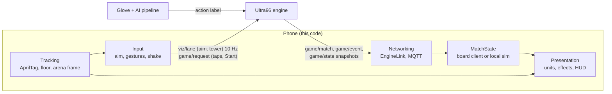
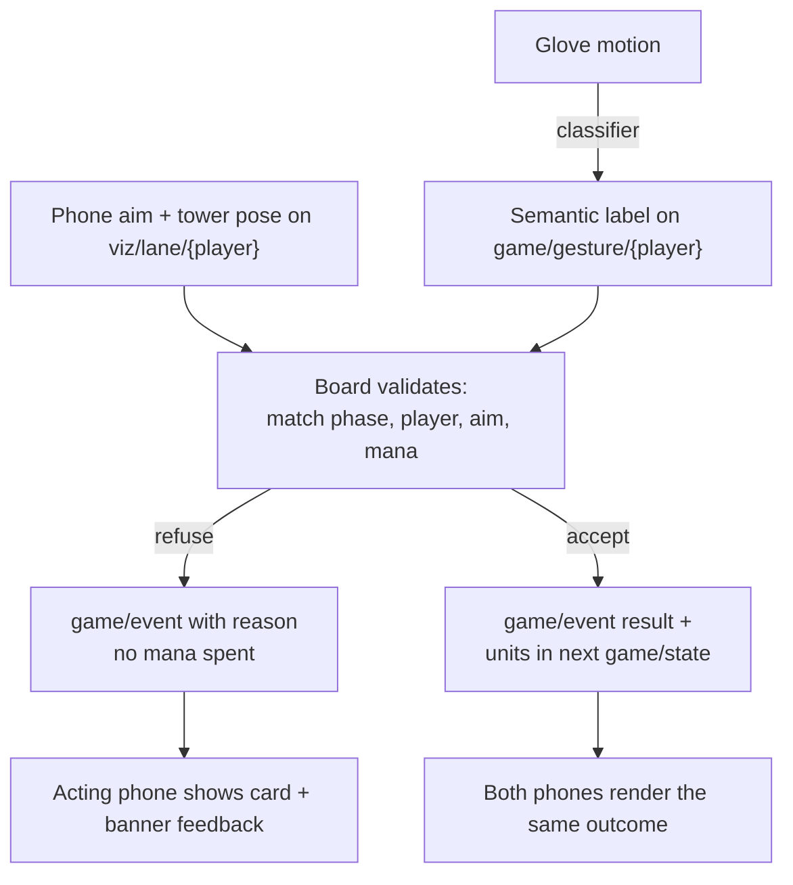
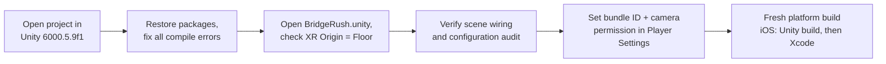

# BridgeRush Software Visualiser (SW_Visualiser)

The Software Visualiser is the Unity AR application on each player's phone in BridgeRush, a two-player AR tower-defence game (CG4002, Group B16). It overlays the arena, two islands joined by two bridges with a tower on each side, on the live camera feed, turns the player's aim and movement into game input, and renders the match the Ultra96 game engine decides.

Each phone tracks the opponent's worn AprilTag and uses its own device pose for the near end of the arena. Positions cross the network as normalised arena coordinates (`along` 0 to 1 from Player 1 to Player 2, `lat` normalised by lane width), so the two phones never need to share an AR coordinate origin.

## What the player can do

| Player action | How |
| --- | --- |
| Prepare a match | Pick VS PLAYER, VS CPU or TUTORIAL, pick a player, scan the floor and opponent tag, lock in, press Start |
| Summon units and cast spells | Glove gestures classified by the AI pipeline (Warrior, Rogue, Mage, Tank, Hero, Lightning, Fireball); card taps as backup |
| Aim | The centre-screen crosshair projects onto the floor; rings show placement validity and spell radius |
| Place the tower | Shake the phone sideways to lock or release the tower position |
| Capture bubbles | Hold the crosshair on a bubble on the opponent's tower to earn mana; the defender gets a warning |
| Follow the battle | Unit models and animations, tower HP bars, mana, timer, damage flash, haptics, sounds and music |
| Recover and replay | Automatic reconnection and pause handling; result screen with Play Again |

## Architecture

In VS PLAYER, the Ultra96 is the only authority for validation, mana, combat and the result. The phones publish input and render what the board sends back. VS CPU and the tutorial run a local C# simulation instead, so one phone can run alone.

The action path separates recognising an action from executing it. A refused action costs nothing and explains itself on screen.

### Script layout (`script/`)

| Folder | What it does |
| --- | --- |
| `Tracking/` | `AprilTagTracker` (portrait image rotation, focal rescaling, tagStandard41h12 detection), `ArenaFrame` (lane axis, smoothing, last-pose hold), `FloorHeightProvider` (downward raycast with lowest-plane fallback and per-device offset), `CameraRollCorrection`, `MatchSetup` |
| `Input/` | `SummonCursor` (floor aim, deployment and spell validity), `GestureBindings` (semantic label table), `GloveGestureReceiver`, `ShakeDetector` and `TowerShakeInput` (tower lock) |
| `Match/` | `MatchState` partials (`.Economy`, `.Combat`, `.Geometry`, `.Spells`, `.Network`, `.Engine`), `UnitState`, `UnitStatsTable`, `UnitPrefabCatalog` |
| `Networking/` | `MqttConnection` (envelope, de-dupe, reconnect), `Engine/` (`EngineLink`, `EngineLinkCore`, `EngineMessages`: the board client), `Sync/` (ready, lock, countdown, bubbles), `Glove/`, `Comms/` (comms team's drop-in, copied unchanged, edit only in the comms repo) |
| `Gameplay/` | `GameStateRenderer` (one `UnitView` per unit ID, snapshot interpolation), `SpellCaster`, `TowerController`, `ArDepthClear`, `Environment/` (bridges, water, pedestals), `Bubbles/`, `GameAudio`, `GameMusic`, `Haptics`, `ReticleArt` |
| `UI/` | `SetupScreen`, `CardHandUI` (mana glow, motion tracer), `MatchHudUI` (bars, timer, damage flash), `OptionsWindow`, `HowToPlayWindow`, `BubbleWarningUI`, `DebugMenu` |
| `Tutorial/` | `TutorialFlow` (ten steps: lock, release, capture, each unit twice, both spells), `TutorialCoach` |
| `engine/` | The Python match core (`match.py`, `rules.json`, version `scene-checked-13nov-r8-mana-regen-033`) and `run_laptop_engine.sh`, the laptop isolation harness |
| `plugins/iOS/` | `BridgeRushHaptics.mm`, the native Taptic Engine bridge (copy into `Assets/Plugins/iOS/`, iOS only) |

`script/` is mirrored into `My project/Assets/Script/`; keep the two trees identical.

### MQTT interface

Every message is wrapped in the comms envelope (`event_id`, `source`, `seq`, `ts`, `payload`), type-checked and de-duplicated on `event_id`.

| Topic | Phone direction | Purpose | QoS |
| --- | --- | --- | --- |
| `game/match` | receive | Match ID, phase, Start acknowledgements, winner, rules version, tick rate | 1 |
| `game/state` | receive | Units, strikes, tower HP, mana, time, tick | 0 |
| `game/event` | receive | Action result, reason, created unit ID | 1 |
| `game/request/{player}` | publish | Start, rematch, card actions with request ID and aim | 1 |
| `viz/lane/{player}` | publish | Lane validity, tower position, lock state, aim (10 Hz after lock-in) | 0 |
| `viz/lane/{opponent}` | receive | Peer tower position in canonical coordinates | 0 |
| `game/gesture/{player}` | receive | Classifier label (observed, not executed, when a board client) | shared config |
| `viz/bubble_captured/{player}` | publish | Capture identity and match ID | publish default |
| `bridgerush/bubble/player1-2` | both | Bubble targeting flag and progress for the defender warning | 0 |

## Reproducing the build

### Requirements

- Unity **6000.5.9f1** with AR Foundation, ARKit and ARCore 6.5.0, URP 17.0.3, Input System 1.19.0, Newtonsoft JSON 3.2.2; `jp.keijiro.apriltag` from GitHub; MQTTnet 4.3.7 and SSH.NET as plugins. The package lock in `My project/Packages/` restores these.
- The full Unity project (`Assets`, `Packages`, `ProjectSettings`, including the scene, prefab catalog, stats assets, models, shaders, native plugins and `.meta` files). Scripts alone do not reproduce the app.
- Multiplayer additionally needs two AR phones, printed tagStandard41h12 markers, the glove and classifier pipeline, and the Ultra96 engine and comms deployment. One phone with the synthetic opponent runs alone for development.

### Build steps

1. Open `My project/` in Unity 6000.5.9f1 and let it compile. One compile error anywhere blocks every script from registering, so fix errors first.
2. Open `Assets/Scenes/BridgeRush.unity`. Confirm `XR Origin` Tracking Origin Mode is **Floor**, with the AR camera, `ARCameraManager`, `ARPlaneManager` and `ARRaycastManager` present and the right provider (ARKit or ARCore) enabled.
3. Verify the core wiring: `AprilTagTracker`, `ArenaFrame`, `FloorHeightProvider`, `MatchState`, `TowerController`, `SummonCursor`, `GameStateRenderer`, with `UnitStatsTable` and `UnitPrefabCatalog` assigned for all five units. `EngineLink` must reference `MqttConnection`, `MatchSetup`, `MatchState` and `PeerReadySync`. Keep `BubbleCaptureManager`, `BubbleSync` and `BubbleWarningUI` wired, and only one gesture consumer per scene (`AiGestureHook` or `GloveGestureReceiver`, not both, since `MqttConnection` keeps one handler per topic).
4. On `MqttConnection`: broker `127.0.0.1`, port 1883, Connect On Start **off** when using the Comms tunnel. A broker host saved on the phone (`broker_host.txt`) overrides the Inspector value.
5. Set the bundle identifier and camera usage description in Player Settings, not in Xcode. iOS needs a fresh Unity build before opening Xcode; re-running Xcode on a stale build picks up nothing. Android needs the VIBRATE permission for haptics and the ARCore checks.

### Configuration audit

Scene values override code defaults, and saved device preferences override both, so record the effective values rather than trusting defaults:

| Setting | Expected | Watch out for |
| --- | --- | --- |
| Tag size | Effective detector value per phone | Scene holds 0.185 m; a device preference may hold the calibrated 0.119 m |
| Mana regeneration | 0.33/s (board rules) | An obsolete saved field is not the active setting |
| Bubble hold / reward | 1.5 s / 2 mana | Matches board rules |
| Bubble respawn | Align scene (0.5 s) with board rules (1 s) before release | Known discrepancy |
| Unit height | 0.25 m before arena scaling | Older notes say 0.15 m; use the saved scene value |
| Smoothing / floor | SmoothDamp 0.12 s; fallback plane at least 0.6 m below phone | Floor offset and quarter-turn corrections persist per device |

### Calibration

1. Measure the printed tag's black-border edge (that edge, not the paper, is the tag size) and set it per phone; verify the reported distance against a tape measure at several separations.
2. Use an off-centre tag to tell tag-frame error from camera-roll error; the two quarter-turn corrections are separate on purpose and persist per device.
3. Scan the floor in good light, confirm the selected plane, and apply the per-device floor offset only after confirming the surface.
4. Confirm `along = 0` is Player 1 and `along = 1` is Player 2 on both phones, and compare an off-centre point on both bridge sides; a centreline-only test hides a mirrored lateral axis.

### Functional verification checklist

Run after any build, in this order:

1. **Tutorial / VS CPU** (no hardware needed): all five units, both spells, shake lock and release, bubble capture reward, insufficient-mana refusal, the timeout result and Play Again.
2. **Multiplayer**: two phones with different player identities, lock-in, synchronised start, the same match on both screens, a controlled interruption (kill the link, watch the pause and the recovery), and rematch.
3. Keep a screen recording of the pass for the demo video.

### Testing without the hardware chain

- `engine/run_laptop_engine.sh` starts a local broker, simulated glove readiness and the engine core for isolation testing on a laptop.
- `BubbleSync`'s **Mock Ultra96 Offline** toggle awards captures locally and loops your own lock back as the defender warning.
- The **debug menu** (gear, DEBUG) has per-gesture test buttons, God mode, a jump to the last minute, tracking readouts (lane length, floor height, camera info) and the Comms connect panel.
- `Comms/laptop/mqtt_client.py --publish-every` publishes glove events without a glove.
- The retained software checks (wire-case generation, C# parsing checks, 900-snapshot engine run) and their outcomes are recorded under `docs/report_vis/evidence/` with source hashes.

### Troubleshooting

| Symptom | Likely cause and fix |
| --- | --- |
| Arena sideways under an upright camera | Camera-roll correction needed, not a tag fix; use the separate quarter-turn controls |
| Tower floats | Floor fallback picked the wrong plane, or XR Origin is not in Floor mode; check the Tracking readout, then the per-device floor offset |
| Tag distance wrong and changes with tilt | Tag size or intrinsics mismatch; re-run the tape-measure calibration |
| Nothing reacts to the glove | Two consumers on `game/gesture/{player}`, or the classifier emits labels outside the accepted vocabulary (warrior, rogue, mage, tank/shield, hero, lightning, fireball, case-insensitive) |
| Start works on one phone only | The other phone has no current-match snapshot yet; check broker connectivity and `game/match` |
| A changed code default has no effect | The scene saves its own value; change it in the Inspector |

## Credentials

SSH usernames, passwords, hostnames and the VPN configuration for the board tunnel are private. They never go in this repo or its docs.
